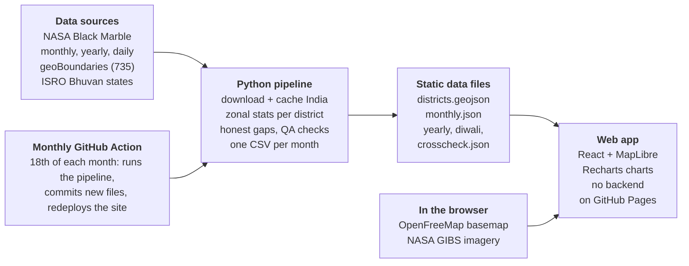

# India Night Lights: project overview

*As of 15 November 2026*

## What it is

India Night Lights is a free, public web map of how bright each of India's 735 districts is at night, month by month from 2015 to today, built from NASA satellite data. Night-time brightness is a rough proxy for electrification, economic activity and urban growth.

- **Live site:** [manishkkk18.github.io/india-night-lights](https://manishkkk18.github.io/india-night-lights/)
- **Code:** this repository
- **For:** anyone curious about India's growth, and as a portfolio piece showing data pipeline, mapping and product work end to end.

## Data and method

Every number on the site is a per-district average of NASA Black Marble radiance (nW/cm²/sr, ~500 m pixels), computed by our own pipeline.

| Input | Source | Used for |
| --- | --- | --- |
| Monthly night lights | NASA Black Marble VNP46A3, Collection 2 | The map, ranks, trends |
| Yearly night lights | NASA Black Marble VNP46A4 | Long-term trend line |
| Daily night lights | NASA Black Marble VNP46A2 | Diwali effect, 8 cities |
| District boundaries | geoBoundaries IND (LGD via Pathways Data, 2021, ODbL), release 9469f09 | 735 districts, India outline |
| State cross-check | ISRO Bhuvan night-lights statistics, 2012–2024 | Validating our state trends |

- **Per district, per month:** mean radiance, sum of lights, % of area lit (≥ 1 nW/cm²/sr) and % of area actually observed.
- **Honest gaps:** pixels NASA gap-filled from past data are dropped. A district under 50% observed is shown hatched, never estimated.
- **Growth since 2015:** compared with the same calendar month in 2015, so seasonal swings cancel out.
- **Bhuvan cross-check:** both series indexed to 2015 = 100, because Bhuvan defines its statistic differently. Agreement is measured before its 2024 switch to a new NASA collection.

## Architecture

There is no server: a Python pipeline does the heavy work offline and writes small JSON files, and the website only reads those files.

Raw NASA files (~1 GB per month) never reach the repo; only the compact outputs do. The basemap and NASA's satellite imagery load straight from their providers in the visitor's browser.

| Folder | What's in it |
| --- | --- |
| `pipeline/` | Python: boundaries, monthly/annual/daily processing, Bhuvan cross-check, tests. See [pipeline/README.md](../pipeline/README.md). |
| `data/` | Small outputs the site reads, plus one CSV checkpoint per processed month. Raw downloads live in `data/raw/` and are not committed. |
| `web/` | Vite + React + TypeScript + MapLibre site. |
| `.github/workflows/refresh.yml` | The monthly refresh. |

## Features

The site opens on a globe, flies in to India, and lets you explore from country level down to street level.

- **District map:** dark → amber → white on a log scale, glow on bright districts, shading fades past city zoom so streets show through. Hover for a tooltip; click or search to select and fly to a district.
- **Time slider and Play:** step or animate through every month since 2015; unprocessed months show as gaps with a notice.
- **Radiance / Growth since 2015 toggle:** growth uses a red (dimmer) to blue (brighter) scale.
- **Layers:** district brightness, NASA Black Marble 2016 image, or a NASA daytime satellite image (21 Feb 2026).
- **3D lights skyline:** districts rise by brightness on a tilted globe.
- **Before / after swipe:** a draggable handle compares two months side by side.
- **Side panel** (bottom sheet on phones): radiance, lit and observed area, 1-year and 5-year change, national and state rank, trend chart, CSV download.
- **Search** finds districts by official or common names (Bengaluru, Gurugram, Kochi, Noida, and about 40 more).
- **Insights:** fastest brightening since 2015 and brightest districts; rows fly to the district.
- **Compare:** two districts side by side, with both trends on one chart.
- **The Diwali effect:** how much brighter 8 major cities are on Diwali night than on normal nights.
- **Cross-check with ISRO Bhuvan:** our state trends next to Bhuvan's.
- **About the data:** sources, method, caveats and credits on the page.

## Key decisions and caveats

The project favours honesty and zero running cost over polish: no backend, no paid services, no invented numbers.

| Decision | Why |
| --- | --- |
| Static files only, hosted on GitHub Pages | Free, fast, nothing to maintain; the web data stays well under 5 MB |
| Drop NASA's gap-filled pixels; hatch districts under 50% observed | Cloudy months must show as gaps, not as guessed values |
| Keep a compressed India-only raster per month, delete NASA's raw files | Raw data is ~1 GB per month (~140 GB in total); the cache is ~9 MB per month |
| OpenFreeMap basemap with its OpenStreetMap borders hidden | Free with no key; India's outline is drawn from boundary data that follows the official national outline |
| Boundaries simplified to ~1 km | Keeps the map file to ~0.4 MB transferred; edges look approximate at street zoom |
| Growth list only counts districts already lit (≥ 1 nW) in 2015 | Stops near-dark districts topping the list at "+500%" |
| Charts load only when needed | Keeps the first visit at ~375 KB of code |
| Boundaries pinned to one geoBoundaries release | Automated refreshes can never silently change district IDs |

**Caveats:**

- Night lights are a proxy, not GDP: gas flares, fishing fleets and festivals light up too.
- 735 districts (2021); districts created since are counted within their parent district.
- NASA's Suomi NPP satellite is ageing; a future switch to NOAA-20/21 may cause a level shift.
- Fireworks smoke can dim the satellite's view on Diwali night, so a small Diwali effect doesn't always mean fewer lights.
- Bhuvan's figures use a different statistic and switch NASA collection in 2024, so only trends are compared, up to 2023.

## Status and how to run it

All seven planned phases are built and the site is live; the full 2015–2026 history is still downloading.

| Phase | What | State |
| --- | --- | --- |
| 1 | Pipeline for one month, sanity checks | Done |
| 2 | Web map, globe intro, side panel | Done |
| 3 | Backfill 2015–2026, slider, Play, Growth toggle | Octobers 2015–2025 done; full month-by-month pass running |
| 4 | Layers, 3D skyline, faster first load | Done |
| 5 | Trend chart, yearly pipeline, search names, state rank | Done; yearly data runs after the backfill |
| 6 | Insights, compare, before/after swipe, Bhuvan cross-check | Done |
| 7 | Diwali effect, monthly refresh Action | Built; Diwali 2025 processing; Action needs the `EARTHDATA_TOKEN` secret |

**Run it locally** (full steps in [pipeline/README.md](../pipeline/README.md) and the [main README](../README.md)):

1. Put a NASA Earthdata token in `.env` as `EARTHDATA_TOKEN=...`.
2. Pipeline, from `pipeline/`: `python -m nightlights.boundaries`, then `bash backfill.sh`, then `nightlights.annual`, `nightlights.crosscheck` and `nightlights.diwali`.
3. Web, from `web/`: `npm install`, `npm run dev`; `npm run deploy` publishes to GitHub Pages.
4. Add `?perf` to the site's address to see load timings on any device.

**Keeping it current:** the GitHub Action runs on the 18th of each month, processes new NASA months, refreshes the Bhuvan cross-check and redeploys. Each year, add that year's Diwali date to `pipeline/nightlights/diwali.py`.
